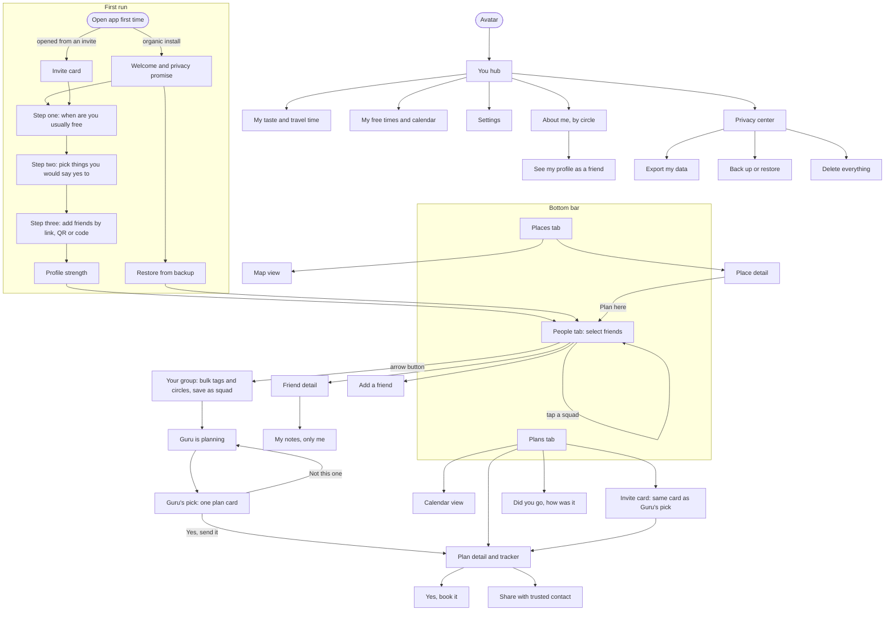

# Plans Guru — Screen Map (v1, hackathon)

Scope: going out to eat, Austin only. Everyone in a plan needs the app.
Words like "Place" and "Plan" (not "Restaurant" / "Dinner") are used in screen
names so the same screens can later cover any activity in any city.

Clickable wireframe: [`docs/wireframes/people-to-plan.html`](wireframes/people-to-plan.html)
(download and open in a browser; GitHub shows HTML as source code).
Mascot sheet: [`docs/brand/guru-mascot-sheet-v1.webp`](brand/guru-mascot-sheet-v1.webp).

## Navigation structure

```
┌─────────────────────────────────────┐
│ (Avatar)  People               ⋮    │  ← avatar opens the "You" hub
│ [ Search friends               ]    │
│ (Maya ×) (Jo ×)                     │  ← selected people, like WhatsApp New group
│                                     │
│ ☐ friend list…                (→ 2) │  ← arrow button continues with selection
├─────────────────────────────────────┤
│   People   │   Places   │  Plans ●2 │  ← ●2 = invites waiting for your answer
└─────────────────────────────────────┘
```

- **People** is the default tab and *is* the "who" picker. There is no separate "Who?" screen.
- The human picks **only who**. The Guru picks what, when, and where, and offers **one** plan: yes or no.
- On Places and Plans, a **+ Plan** button jumps to People with selection ready.
- **You hub** (avatar) holds About me, taste, free times, privacy, export/backup, settings.
- No chat anywhere. No notification inbox: invites live in Plans.

## Map



## Screen inventory

### First run
| Screen | Notes |
|---|---|
| Invite card (first run) | If the app was installed from an invite, this is the very first screen. Answer first, profile second. |
| Welcome | Guru mascot, one-line privacy promise. "Restore from backup" link here too (new phone case). |
| Onboarding 1–3 | Free times (skippable) → yes-to picker (tap cards, no typing) → add friends. |
| Profile strength | "Your plans get better as your Guru learns you." Worded as benefits, not a score. |

### People (default tab) — modeled on WhatsApp "New group"
| Screen | Notes |
|---|---|
| People | Search box (no keyboard/number-pad toggle). Selected people appear as a row of avatars with ×. Saved squads as quick-start chips. Tap a row to select; tap the photo to open the friend. Arrow button continues. |
| Your group | Like WhatsApp's second "New group" screen. Optional name + "Save as squad". Bulk bar: select all, Tag, Circle, Undo. Per-person rows show circle + tags. Big button: **Ask the Guru**. |
| Friend detail | What they've shared with you · **My notes 🔒** · circle · tags · plans together. |
| Add a friend | Share invite link, show my QR, scan QR, enter code. Manual only, no suggestions. |

### Guru's pick (one option)
One plan card: **who, what, when, where**, plus a high-level "why" ("Fits everyone's schedule and tastes"). Never a private reason.
Buttons: **Not this one** (quick reason chips, then the Guru tries again) / **Yes, send it**.

### Plans
| Screen | Notes |
|---|---|
| Plans list | Sections: Needs your answer · In motion ("2 of 4 in, needs 3 by Wed") · Upcoming · Past. List/Calendar toggle. |
| Invite card | The same plan card as Guru's pick. Buttons: I'm in / Maybe / Can't make it. |
| Plan detail | Tracker: Proposed → Gathering → Booking → Happening. Who's coming with status. Deadline as a plain date. Directions, Add to my calendar, Share with trusted contact. Organizer: **Yes, book it** (unlocks when enough people are in), Cancel plan. |
| Did you go? / How was it? | Pops up once after the scheduled time. Skippable; reachable later from Past. Venue and activity only: Do it again / Once was enough / Not for me. Never rates people. |

### Places
| Screen | Notes |
|---|---|
| Places list | List/Map toggle. Filter chips: cuisine, price, travel time, open now. Sections: "For you", "A little further, worth it". |
| Place detail | Photos, "Why you might like it", 👍/👎 + what you liked (tags). "Plan here" → People to pick who. |
| Sponsored label | Always visible: "Sponsored · +4.5 of 100 points (max 5). Would rank #2 without it." |

### You hub (avatar, top-left, from any tab)
| Screen | Notes |
|---|---|
| About me, by circle | One box per privacy level (see below). **View as…** button shows exactly what one friend sees. |
| My taste | Interests, diet, budget, drinks, vibe, accessibility, travel radius in minutes. |
| My free times | Paint a week, connect a calendar, "I'm free right now". |
| Privacy center | What I've shared and with whom · connected calendars · **Export my data** · **Back up / Restore** · **Delete everything**. |
| Settings | Notifications · **Nearby: "I use Plans Guru"** (off by default; both people must turn it on) · about. |

## Privacy levels

Each fact or note about me goes in one box. A friend sees their own level and every level below it.

| Box | Who sees it |
|---|---|
| 🔒 Only me | Nobody. Still shapes suggestions. |
| Circle 1 · Inner circle | People in Circle 1. |
| Circle 2 · Close friends | People in Circle 1 and Circle 2. |
| All friends | Everyone you've added on Plans Guru. |

- Each friend is in **exactly one** circle (Circle 1, Circle 2, or just "Friend"). The circle is the only tag that controls privacy.
- **Tags** ("salad crew", "taco crew") are for grouping and quick starts only. Any number per person. They never control privacy. Optional "exclusive" tags (a person can only have one) are a later feature.
- **Saving:** tag changes are private and save instantly. Circle changes and About-me edits change what other people see, so they save locally as drafts and only sync after **Share changes**. Undo works on anything not yet shared; "Discard" returns to the last shared version.

## Calendar: where it appears
| Entry point | What it shows |
|---|---|
| Plans tab → Calendar toggle | Your plans laid out on a calendar. |
| You → My free times | Your availability (when the Guru may schedule you). Not the same as plans. |
| Plan detail → Add to my calendar | Copies one plan into the phone's own calendar app. |

## Notifications
Plain, no reminders or streaks. Lock-screen text never reveals details:
- "You've been invited to an event."
- "A plan happening soon was updated."

## Invite text (sent from the organizer's phone)
> You've been invited to a plan on Plans Guru. Get the app to say you're in —
> your Guru handles the what, when and where, so nobody has to coordinate by hand.
> [link]

## Guest list rule (proposed)
Invitees see everyone coming: first name and photo. People who aren't their friend are labeled "Dee's friend", and their profiles can't be opened. Reason: knowing who will be at the table is a safety need, and being in a plan means agreeing to be seen by the others in it.

## Screenshots
Blocked app-wide in release builds (Android `FLAG_SECURE`). This also blocks screen recording and casting, so **debug builds leave it off** so the demo video can be recorded.

## Gaps for the backend (buttons exist, functionality needed)
- **Export my data**, **Back up**, **Restore** (Welcome screen + Privacy center). Note `allowBackup=false` today: a new phone loses everything.
- **Opening an invite after installing from the store link** (the invite has to survive the install). For the demo, both phones already have the app.
- **"Why" text that is safe to show other people.** The front end only displays high-level reasons; the backend should never send private-note reasons to other phones.
- **"Not this one"**: the Guru needs a next-best plan, ideally using the reason chip.
- **Sponsored boost numbers**: boost amount, cap, and "rank without sponsorship" per suggestion.
- **Squads, tags, circles**, and the **draft vs. shared** sync model.
- **Restaurant booking**: who confirms on the restaurant side, and does the restaurant need an app?
- **Nearby "I use Plans Guru"**: mutual opt-in only.
- **Degoogled phones** (one demo phone runs /e/OS): avoid depending on Google Play Services for maps, push notifications, or the install referrer.
