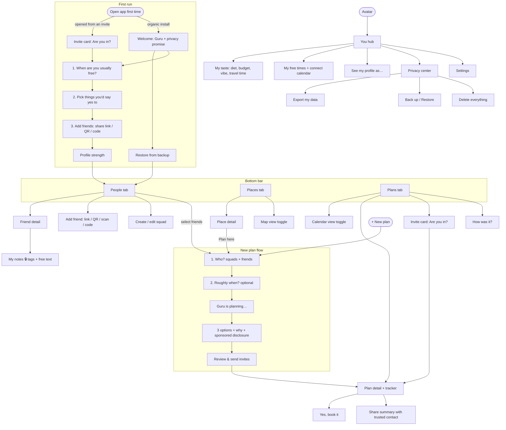

# Plans Guru — Screen Map (v1, hackathon)

Scope: going out to eat, Austin only. Everyone in a plan needs the app.
Words like "Place" and "Plan" (not "Restaurant" / "Dinner") are used in screen
names so the same screens can later cover any activity in any city.

## Navigation structure

```
┌─────────────────────────────────────┐
│ (Avatar)        Plans Guru          │  ← Top bar: avatar opens the "You" hub
│                                     │
│            tab content              │
│                                     │
│                     [ + New plan ]  │  ← Floating button, on every tab
├─────────────────────────────────────┤
│   People   │   Places   │  Plans ●2 │  ← Bottom bar. ●2 = count of invites
└─────────────────────────────────────┘     waiting for your answer (no nudges)
```

- **People** is the default tab.
- **+ New plan** only asks *who*. The Guru picks what, when, and where.
- **You hub** (avatar) holds profile, free times, privacy, export/backup, settings.
- No chat anywhere. No bell/notification inbox: invites live in Plans.

## Map



## Screen inventory

### First run
| Screen | Notes |
|---|---|
| Invite card (first run) | If the app was installed from an invite, this is the very first screen. Answer first, profile second. |
| Welcome | Guru mascot, one-line privacy promise. "Restore from backup" link here too (new phone case). |
| Onboarding 1–3 | Free times (skippable) → yes-to picker (tap cards, no typing) → add friends. |
| Profile strength | "Your plans get better as your Guru learns you." Worded as benefits, not a score. |

### People (default tab)
| Screen | Notes |
|---|---|
| People list | Squad chips across the top (All, BBQ crew, Salad friends, + New). Tap friends to select → "Make a plan with 3". |
| Friend detail | What they've shared with you · **My notes 🔒** ("Only you see this") · squads they're in · plans together. |
| Add friend | Share invite link, show my QR, scan QR, enter code. Manual only, no suggestions. |
| Squad edit | Name + members. Squads are just groups; they don't control privacy. |

### Places
| Screen | Notes |
|---|---|
| Places list | List/Map toggle. Filter chips: cuisine, price, travel time, open now. Sections: "For you", "A little further, worth it". |
| Place detail | Photos, "Why you might like it", 👍/👎 + what you liked (tags). "Plan here" → New plan flow with this place preset. |
| Sponsored label | Always visible: "Sponsored · +4.5 pts of 100 (max 5). Would rank #2 without it." |

### Plans
| Screen | Notes |
|---|---|
| Plans list | Sections: Needs your answer · Upcoming · In motion ("3 of 5 in, needs 4 by Wed") · Past. List/Calendar toggle top-right. |
| Invite card | What, when, where, who's in, why. Buttons: I'm in / Maybe / Can't make it. |
| Plan detail | Tracker: Proposed → Gathering → Booking → Happening. Place card + map. Deadline (plain date, no ticking timer). Add to my calendar. Share summary with trusted contact. |
| Yes, book it | Explicit confirmation. Nothing is booked without it. |
| How was it? | Venue and activity only: Do it again / Once was enough / Not for me. Never rates people. |

### New plan flow (from + New plan, People selection, or Place detail)
1. **Who?** Squads + friends. Pre-filled if you came from People.
2. **Roughly when?** Optional chips: This week / This weekend / Let the Guru pick.
3. **Guru is planning…** Mascot animation with honest status text.
4. **Options**: top 3 cards, each with a "Why" line and any sponsored disclosure. Shuffle for more.
5. **Review & send**: summary, then Send invites (opens the phone's share sheet / sends to app users).

### You hub (avatar, top-left, from any tab)
| Screen | Notes |
|---|---|
| My taste | Interests, diet, budget, drinks, vibe, accessibility, travel radius in minutes. Each fact has an **Only me** toggle. |
| My free times | Paint a week, connect a calendar, "I'm free right now". |
| See my profile as… | Pick a friend, see exactly what they see. |
| Privacy center | What I've shared and with whom · connected calendars · **Export my data** · **Back up / Restore** · **Delete everything**. |
| Settings | Notifications, Nearby (off by default), about. |

## Calendar: where it appears
| Entry point | What it shows |
|---|---|
| Plans tab → Calendar toggle | Your plans laid out on a calendar. |
| You → My free times | Your availability (when the Guru may schedule you). Not the same as plans. |
| Plan detail → Add to my calendar | Copies one plan into the phone's own calendar app. |

## Notifications
Plain, no reminders or streaks. Lock-screen text never reveals details:
- "You've been invited to an event."
- "A plan happening soon was updated."

## Invite text (sent from the organizer's phone)
> You've been invited to a plan on Plans Guru. Get the app to say you're in —
> your Guru handles the what, when and where, so nobody has to coordinate by hand.
> [link]

## Gaps for the backend (buttons exist, functionality needed)
- **Export my data**, **Back up**, **Restore** (Welcome screen + Privacy center). Note `allowBackup=false` today: a new phone loses everything.
- **Opening an invite after installing from the Play Store link** (the invite has to survive the install, e.g. via the Play Install Referrer API). For the demo, both phones can already have the app.
- **"Why" reasons that are safe to show other people.** The front end will only display reasons marked shareable; the backend should never send private-note reasons to other phones.
- **Sponsored boost numbers**: boost amount, cap, and "rank without sponsorship" per suggestion.
- **Squads**: stored groups of friends.
- **Per-fact "Only me"** visibility.
- **Restaurant booking**: who confirms on the restaurant side, and does the restaurant need an app?
- **Nearby "I use Plans Guru"**: must be mutual and off by default (safety); suggest leaving it out of the hackathon demo.
